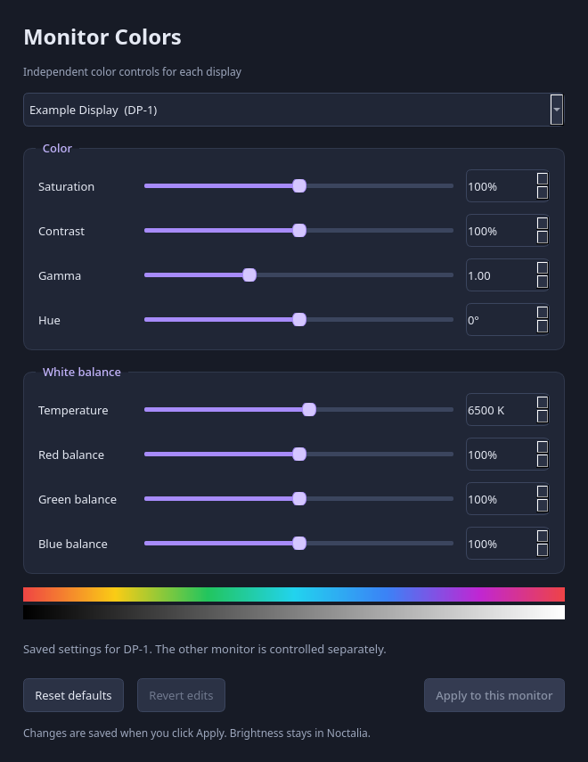

# Monitor Colors

Independent saturation, contrast, gamma, hue, white balance, and RGB controls for monitors managed by Hyprland's Lua configuration. The app builds ICC profiles using Little CMS and attaches them to existing monitor rules.

These are creative color adjustments, not measured display calibration. The app is intended for the SDR desktop whilst HDR behavior has not been validated.

I'm currently running the app on CachyOS with Noctalia Hyprland 0.56.2 on NVIDIA drivers adding a configurable monitor selection if anyone needs to, but I've never live tested on different desktops, distros or GPUs

This app was created by local LLM models on Ollama / QwenCode. I do not take the work under my ownership, I'm just uploading it just incase anyone else wants something similar to it :)

### UI Preview:


## Installation
```bash
python -m venv .venv
source .venv/bin/activate
python -m pip install -r requirements.txt
python monitor_colors.py
```

##  Requirements
- A Hyprland session with Lua monitor rules and ICC support
- `hyprctl` available in your command path
- Python 3.10 or newer, NumPy, PySide6, and the Little CMS 2 shared library

Arch packages:
```bash
sudo pacman -S python python-numpy pyside6 lcms2
```


## Install and run

On Arch Linux / CachyOS, install dependencies:

From this repository, run:

```bash
python monitor_colors.py --list-monitors
```

This read-only command prints connected connector-to-model pairs. Create
`~/.config/monitor-colors/monitors.json` using the exact names it prints:

```json
{
  "DP-1": "YOUR EXACT MONITOR MODEL",
  "HDMI-A-1": "YOUR OTHER MONITOR MODEL"
}
```

List only the monitors you want the app to manage. Connector names can change after reconnecting displays, so make sure to update the mapping if that happens.

Your selected monitors must already have rules in
`~/.config/hypr/config/monitors.lua`, with one connector-based `hl.monitor`
block per monitor. Preserve your existing mode, position, and scale by adding:

```lua
hl.monitor({
    output = "DP-1",
    -- Keep your existing mode, position, scale, and other fields here.
})
```

The configuration editor expects the opening `hl.monitor({` and closing `})` on their own lines, as shown. It does not edit selectors, monitor rules, or arbitrary Lua layouts

When using, choose a monitor, adjust the sliders, and press **Apply to this monitor**. Reset returns the controls to their defaults; press Apply to save that reset. Revert discards the current unsaved edits. Nothing is perma changed in system-wide configs, so don't fret :D


## CLI:

```bash
# Read saved settings; does not verify that those profiles are active.
python monitor_colors.py --show

# Retain other saved controls and change saturation on one monitor.
python monitor_colors.py --monitor DP-1 --saturation 110 --apply

# Use alternate mapping and monitor-rule files.
python monitor_colors.py --monitor-map /path/to/monitors.json --config /path/to/monitors.lua
```

Available controls: `--saturation`, `--contrast`, `--gamma`, `--hue`,
`--temperature`, `--red`, `--green`, and `--blue`. Run `--help` for options.
If no monitor is specified, the CLI selects the first entry in the mapping.

## Files and display behavior

Applying changes:

1. Generates a cached ICC profile and JSON metadata under
   `~/.local/share/color/icc/monitor-colors/`.
2. Adds or replaces the selected monitor's app-managed `icc` field.
3. Creates `monitors.lua.before-monitor-colors` beside the monitor-rule file
   if that backup does not already exist. It is an initial backup, not a history.
4. Reloads Hyprland, checks reported configuration errors, and compares output
   resolution, refresh rate, position, scale, transform, and disabled state.
5. Attempts to restore the previous configuration if those checks fail.

## Noctalia users & conflicts

The Noctalia Hyprland Settings plugin can generate additional monitor rules. Hyprland selects the last matching rule as a whole, it does not merge an ICC setting from an earlier rule into a later rule.

The working order on the original setup was:

```lua
require("hyprland-settings")
require("config.monitors")
```

This gives **all** fields in `config.monitors` precedence, including mode, refresh rate, position, and scale. Later layout changes through the plugin may therefore be overridden. Keep one deliberate source of authority for each monitor's complete rule so you don't get confused on which changes which when overriden.

## Tests

Run from the repository root:

```bash
python monitor_colors.py --self-test
QT_QPA_PLATFORM=offscreen python -m unittest discover -s tests -v
```

The self-test checks 15 generated profile transforms through Little CMS. The 12 unit tests exercise color behavior, isolated configs, rollback, explicit monitor mappings, read-only queries, and UI drafts. Tests use temp files, monitor rules, and mocked `hyprctl` calls; they don't apply display settings or reload hyprland

See [VALIDATION.md](VALIDATION.md) for what was actually verified.

The [NVIDIA idle-power notes](docs/nvidia-idle-power.md) describe a separate
manual driver experiment. The color app does not change driver parameters.
